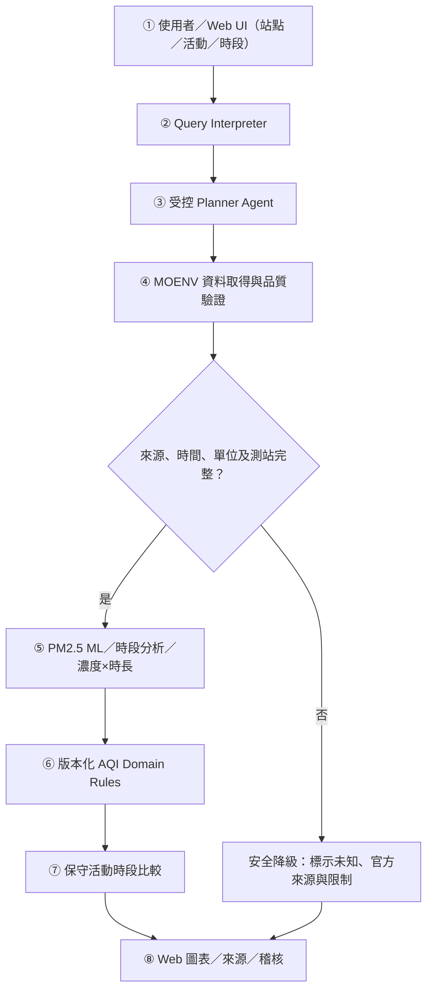
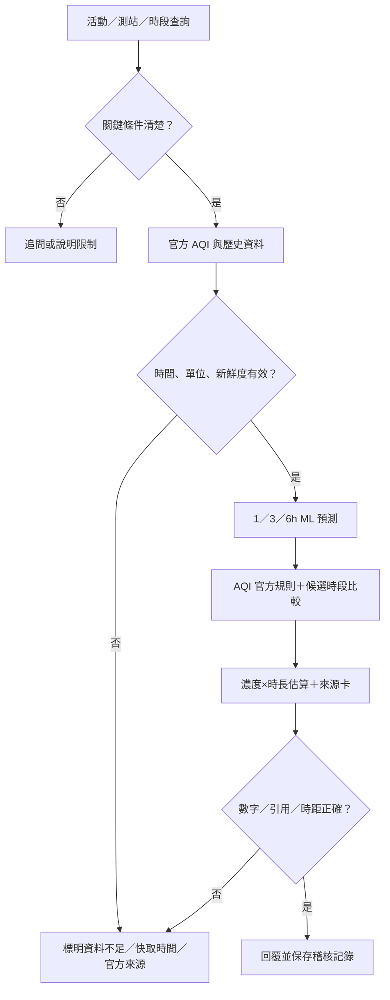

# AirGuard AI｜系統設計文件（可實作版 v3）

**課程**：物聯網數據分析與應用（AIoT-DA）｜**第二組（三人團體）｜組長：林宏陽 7115056179；組員：蔡明憲 7115056013、許鈵昆 8114056002**｜**版本**：2026-11-24 v3  
**定位**：依現存官方公開資料可合理實作並進行驗收的系統設計。**尚未實作或驗證。**

## 1. 研究問題與範圍

以臺中市具備足夠歷史樣本的官方監測站為首批試點，協助使用者在**未來 1／3／6 小時**內比較戶外活動候選時段。系統結合官方 AQI、PM2.5 ML、Agent Tool Calling 與官方分級活動指引，並提供具時間與單位的測站級「濃度×時長」估算。

- **P0**：官方 AQI／歷史小時值、站點地圖、資料品質、ML 短期預測、Agent、官方規則、時段比較、Web、估算暴露、雙軌驗收及安全降級。
- **P1**：SHAP 與手動活動紀錄的累積估算；完成 P0 後再實作，缺資料回報 unknown。
- **不列入**：道路級低污染導航、街區熱點、高解析污染地圖、個人實測吸入劑量與疾病風險診斷。

## 2. 八模組架構



| 模組 | 輸入、任務及可測試產物 |
|---|---|
| ① Web UI | 測站、活動類型、活動時長、一般／敏感族群、候選時段；地圖可選站 |
| ② 查詢解析 | 解析站點與時間（Asia/Taipei）、6h 範圍、缺少條件時追問 |
| ③ Planner Agent | 允許的工具及參數、最大呼叫次數、超時與可檢查 trace |
| ④ 資料取得 | AQX_P_432、488、13、07；資料版本、發佈時間、快取、缺值與 schema 驗證 |
| ⑤ Analytics | 使用時點可得特徵的 1／3／6h 預測、誤差、活動估算指數、P1 SHAP |
| ⑥ Domain Knowledge | 以環境部現行官方 AQI 與一般／敏感族群活動規則為準；分級版本化 |
| ⑦ 決策 | 比較受支援候選時間、保留不確定性、不做未來 AQI 或醫療安全保證 |
| ⑧ 輸出 | 官方值與模型值分卡、時間、站點、單位、來源、估算及限制；稽核紀錄 |

## 3. 官方資料與 API 可行性

| 來源 | 核心欄位 | 用途與限制 |
|---|---|---|
| [AQX_P_432](https://data.moenv.gov.tw/dataset/detail/AQX_P_432) | `siteid, sitename, county, aqi, pm2.5, pm2.5_avg, publishtime` | 即時官方發布值；每小時更新，嚴格區分 `aqi`、當小時 `pm2.5` 與移動平均 `pm2.5_avg` |
| [AQX_P_488](https://data.moenv.gov.tw/dataset/detail/AQX_P_488) | `siteid, datacreationdate, aqi, pm2.5, pm2.5_avg, windspeed, winddirec` | 歷史對照；支援 `filters=siteid,EQ,<id>` 分頁查詢，`published_at_utc` 為 `null` |
| [AQX_P_13](https://data.moenv.gov.tw/dataset/detail/AQX_P_13) | `siteid, itemengname, itemname, itemunit, monitordate, monitorvalue00…23` | 逐時建模主資料；寬表轉長表，已實測驗證臺中市一般站 `28..32`（2024-03-11～2026-11-23）與交通站 `88`（2026-01-02～2026-11-23） |
| [AQX_P_07](https://data.moenv.gov.tw/dataset/detail/AQX_P_07) | `siteid, sitename, county, township, twd97lon, twd97lat, sitetype` | 官方站點 TWD97 座標及地圖（已確認臺中市 6 站），**不代表路段污染值** |
| [AQI 指引](https://airtw.moenv.gov.tw/cht/Information/Standard/AirQualityIndicatorNew.aspx) | 官方 AQI 分級與活動建議 | 規則需記錄生效版次、不可從 PM2.5 濃度自行宣稱官方 AQI |

**API 會員金鑰**：環境部 API 需會員 Key，[官方文件](https://data.moenv.gov.tw/paradigm) 已確認。`MOENV_API_KEY` 僅存入本機 `.env` 或部署 Secrets；歷史原始檔按官方下載方案取用。若 API 不可用，用已核對日期的靜態快照做離線重播，**不得宣稱為現在值**。

氣象特徵：優先評估同一官方污染資料內具合法時間戳的風速／風向；**不把另接中央氣象署 API 當成必要前置**，若新增必須另外申請授權碼及處理站點／時刻對齊。[氣象署資料存取說明](https://opendata.cwa.gov.tw/devManual/description)。

### 3.1 資料契約（最小欄位）

```text
Observation: station_id, pollutant, value, unit, observed_at,
             published_at?, retrieved_at, source_id, source_url, quality_flag
OfficialAQI: station_id, aqi, category, published_at?, retrieved_at, source_url
Forecast:    station_id, origin_at, target_at, horizon_h, pm25_ug_m3,
             model_version, dataset_version, error_reference, interval?
Activity:    station_id, start_at, duration_h, group, activity_type,
             concentration_source, valid_coverage, exposure_index?
Response:    status, official_aqi?, forecast[], activity_windows[],
             advice?, references[], limitations[], trace_id?
```

時間內部統一 UTC、畫面顯示 Asia/Taipei；`published_at` 不可用 `retrieved_at` 代替。每個回測 origin 僅能用預測時已可得資料；若歷史實際發布時間無法重建，註明為**重建歷史回測**。

## 4. PM2.5 預測與可解釋性

- **預測標的**：測站 `s` 在 `t+h` 的**逐時原始 PM2.5 濃度**，`h∈{1,3,6}`，單位 μg/m³；不得將不同平均窗的 PM2.5 直接混入標的。
- **候選特徵**：僅用在 `t` 已可得的 PM2.5 lag 1／3／6／12／24h、過去 3／6／24h rolling 特徵、時刻／星期、經證實可得的風場。缺值旗標需保留，不能跨未來補值。
- **Baselines**：Persistence `ŷ(t+h)=y(t)`、Seasonal Naive `ŷ(t+h)=y(t+h−24h)`（該參考值在 t 前）。
- **ML**：Ridge、Random Forest、XGBoost；不將大型 Transformer、LSTM 視為必做。
- **Protocol**：逐站時間先後約 70／15／15，開發區 Rolling-origin；validation 選模型，test 不參與調參。預先凍結預測起點、特徵與 scoring。
- **Metrics**：MAE、RMSE、`Skill_MAE=1−MAE_model/MAE_Persistence`；基準 MAE 為 0 時回 N/A。分測站、時距、污染事件報告。
- **P1 SHAP**：對最終適用的樹模型使用 TreeExplainer 或相容方法；Ridge 可用係數及相容的 SHAP 解釋。只解釋**模型行為**，非因果結論。

## 5. Agent 工具白名單及 Pseudocode

| 工具 | 目的 | 不得做的事 |
|---|---|---|
| `list_stations` | 取得官方站點清單及座標 | 不推導街道污染熱點 |
| `get_official_aqi` | 取得官方 AQI／時間／來源 | 不以快取冒稱現在值 |
| `get_pm25_history` | 取得逐時資料與品質報告 | 不補造缺失目標 |
| `forecast_pm25` | 回傳固定版模型的 1／3／6h 預測與誤差 | 不外推隔日精確時段 |
| `get_official_guidance` | 取得版本化活動指引 | 不自行變更分級門檻 |
| `compare_windows` | 有來源、有有效資料才比較候選時段 | 不保證健康安全 |
| `estimate_exposure_index` | 計算測站濃度×活動時長 | 不宣稱個人吸入劑量 |
| `verify_output` | 核對數字、單位、引用、時間及安全聲明 | 不讓 LLM 自行解除限制 |

```text
Algorithm 1: AirGuardAgent(query, context)
01 request = ParseQuery(query, context)
02 if NeedClarification(request): return AskRequiredInputs()
03 station = ResolveOfficialStation(request.location)
04 plan = SelectAllowlistedTools(request)
05 live, hourly = LoadOfficialSources(plan)
06 quality = ValidateStationTimeUnitFreshness(live, hourly)
07 if quality.invalid: return LimitedResponse(quality, sources)
08 official_aqi = live.official_aqi
09 windows = ValidateForecastHorizon(request, allowed=[1,3,6])
10 if windows.unsupported: return OutOfHorizonWithSource()
11 forecasts = PredictLockedModels(hourly, windows)
12 guidance = GetVersionedAQIGuidance(official_aqi, request.group)
13 options = CompareSupportedWindows(forecasts, guidance, request)
14 exposure = EstimateConcentrationTime(options, request.duration)
15 result = ComposeSeparateOfficialPredictedEstimated(options, exposure)
16 if not VerifyNumbersUnitsDatesCitations(result): return LimitedResponse()
17 SaveRedactedTrace(); return result
```

## 6. 活動比較與濃度×時間指數

基本可重現指標（不是吸入劑量）：

```text
ExposureIndex = Σ_i C_station_or_model(t_i) × Δt_i
Unit = μg·h/m³
```

- 適用情況：當前／已測得的歷史小時資料，或**6h 內經驗證模型**提供的測站濃度；每段有時間窗及資料來源。
- **活動強度**：僅供活動建議條件與資料註記；沒有可信的呼吸率資料，不計算個人吸入劑量。
- **安全性**：不同測站可僅作區域性參考；預測誤差大或候選時段差異落在誤差範圍內，明示無法可靠排序。
- **P1 每日加總**：僅對已記錄且資料覆蓋的活動加總；缺失小時標示 unknown，不補 0。自訂比較值不等於 WHO／官方認證安全預算。

## 7. Flowchart 與失效路徑



**失效例**：站點歧義、空值、資料延遲、API 失敗、沒有足夠歷史、LLM／模型不可用、請求超出 6h、誤把 PM2.5 當 AQI。若 LLM 不可用仍能用固定工具與官方規則提供**非 Agent**降級版，必須明確標示服務模式。

## 8. 預計實作對應與 API 介面

| 層 | 技術與用途 | API 草案 |
|---|---|---|
| Web | Next.js／React、地圖與折線圖 | 站點／活動表單、官方來源與預測卡 |
| Backend | Python／FastAPI | `GET /stations`、`GET /aqi` |
| ML | scikit-learn／XGBoost／版本化模型 | `POST /forecast` |
| Agent | Function Calling、Tool Allowlist、規則引擎 | `POST /agent/query` |
| Activity | 確定性濃度×時間計算 | `POST /activity/estimate` |
| QA | pytest、固定資料快照、Rolling-origin | `tests/`、`experiments/` |

所有路徑**尚未部署**。API Key 只在 Server 端使用；前端不直接暴露環境部金鑰。

## 9. 驗收設計、風險及範圍決策

- **Track A**：模型與 Persistence／Seasonal Naive 的站點／時距 MAE、RMSE、Skill；另報資料缺值及高污染時段錯誤。
- **Track B**：≥30 測試案例（一般活動、敏感族群、時段歧義、來源失效、超時距、AQI 混淆），記錄工具、來源完整、規則一致、安全降級及 Median/P95。
- **確定性單元測試**：活動濃度×時間、資料缺漏、單位轉換、判斷範圍與官方規則。
- **P1 驗收**：SHAP 圖表對應模型版本、活動記錄不混用不同測站／時間窗。
- **不可做的聲稱**：路線低暴露排名、街道級污染熱點、醫療診斷、已證實減暴露比例、已達成 ML 成效。

完整 [可行性分析](docs/feasibility-audit.md)、[驗收需求](docs/requirements.md)、[資料](docs/data-sources.md)、[評估](docs/evaluation-plan.md)、[修訂原因](docs/decisions/2026-11-24-scope-decision.md)。


## 10. Deep Research 實證補強（2026-11-24）

本組依老師指定 Q1／Q2／Q3 補足五個領域思維模式、三項專業爭論的觀點／原始證據／共識／未解問題，以及十個深入理解題與標準判斷要點。新增 2026 年逐時 PM2.5 預報與戶外活動決策研究，支持「預測誤差不等同可用決策」的實證研究問題；另引用時間序列評估、ReAct 和 OWASP 作為模型／Agent 的可靠性依據。**引用文獻之結果不代表本組實測成效**。詳見 [Deep Research 全文](research/deep-research-v3-evidence-2026-11-24.md)。
