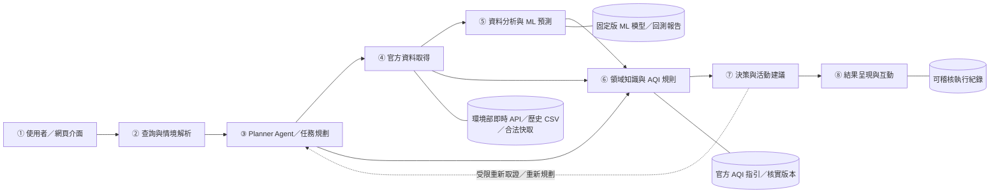

# AirGuard AI — 系統設計文件

**專案名稱**：AirGuard AI｜智慧空氣品質預測與生活決策代理人  
**課程**：物聯網數據分析與應用（AIoT-DA）  
**專題性質**：三人團體期末專題（組員名單依正式分組資料填寫）  
**設計版本**：1.0  
**設計基準日期**：2026-11-04  
**階段**：提案與系統設計（已完成架構及評估規劃；功能尚未實作與驗證）

## 1. 系統目的與研究定位

AirGuard AI 以臺灣環境部官方監測資料為來源，整合 **Domain AI Agent、Domain Knowledge、Data Analytics、Real-World Application**，支援一般使用者在戶外活動前查詢空氣品質、比較短期污染趨勢與取得有依據的活動建議。

### 1.1 預定能力

1. 依城市／監測站、活動、時間及一般／敏感族群條件理解使用者需求。
2. 使用官方資料呈現**最新已發布的 AQI**，並標明監測站、數值時間與來源。
3. 以可重現的 ML 流程預測測站層級未來 **1、3、6 小時 PM2.5**，呈現預測誤差與適用條件。
4. 由領域規則解讀官方 AQI 與活動指引；以不確定性約束時段比較。
5. 遇到資料過期、缺失、API 故障、時段超範圍或規則無法支持結論時，提供明確限制與可查證的替代資訊。
6. 留存不含敏感憑證的資料版本、模型版本、工具執行與決策依據，支援重現與稽核。

### 1.2 系統不提供的能力

- 不提供個人診斷、治療或健康結果保證。
- 不宣稱測站觀測可代表任意街道或個人的精準污染暴露。
- 不將預測 PM2.5 濃度換稱官方 AQI，也不自行發布「官方空品預報」。
- 不以 1／3／6 小時模型外推「明天上午」等超過時距的數值預測。
- 不讓 LLM 直接猜測監測值、改寫 ML 輸出或決定官方分級門檻。

## 2. 使用者、情境與功能需求

| ID | 使用情境 | 必要條件 | 預期輸出 | 失效時處理 |
| --- | --- | --- | --- | --- |
| S1 | 臺中短期慢跑時段比較 | 活動、測站／城市、時間範圍、族群 | 官方目前 AQI、短期 PM2.5 預測、候選時段及理由 | 時距超過 6h 時不捏造預測，改說明範圍或可查的官方資訊 |
| S2 | 敏感族群戶外活動 | 族群、站點、活動、時間 | 與現有官方指引一致的保守風險解讀 | 資料不足或規則不明時，優先提供官方來源及不確定性 |
| S3 | 官方來源延遲／API 無法使用 | 來源狀態與快取時間 | 當前資料不可用說明、歷史資料日期、可用替代資訊 | 不以舊數據冒充即時資訊 |

**功能需求（FR）**：查詢解析、監測站選擇、官方 API／歷史 CSV 取得、品質檢驗、PM2.5 預測、官方領域規則、Agent 工具調度、時段比較、視覺化報告、證據追溯。

**非功能需求（NFR）**：可重現、可測試、安全降級、對外回覆來源透明、呼叫額度限制、合理回應時間與資料來源著作權／授權遵循。性能門檻須經 Pilot 測試後訂定，不預先宣稱已達成。

## 3. 系統架構：八個編號模組

與正式提案的 ①–⑧ 完全對應：



上述箭頭代表主流程與必要的回饋關係；並非每個問題都須呼叫全部工具。完整 Mermaid 原始檔：[`docs/architecture.mmd`](docs/architecture.mmd)。

| 模組 | 功能責任 | 輸入 | 輸出 | 實作對應（預定） |
| --- | --- | --- | --- | --- |
| **① 使用者／網頁介面** | 情境輸入、站點與族群選擇、圖表顯示 | 使用者提問及條件 | QueryRequest | `app/` Next.js |
| **② 查詢與情境解析** | 意圖、時間、地點、活動及族群標準化；必要澄清 | QueryRequest | QuerySpec | `src/airguard/query.py` |
| **③ Planner Agent／任務規劃** | 白名單工具選擇、呼叫順序、有限修正、成本管理 | QuerySpec、工具狀態 | ToolPlan／Trace | `src/airguard/agent.py` |
| **④ 官方資料取得** | 官方 API、歷史 CSV、快取、欄位與時效查核 | 來源與時段條件 | SourceBatch、QualityReport | `src/airguard/data/` |
| **⑤ 資料分析與 ML 預測** | 特徵、基線、1/3/6h 模型預測與誤差資料 | 受驗證測站觀測 | ForecastBundle | `src/airguard/ml/` |
| **⑥ 領域知識與 AQI 規則** | 官方 AQI 規則、活動指引、來源版本與適用條件 | 官方 AQI、族群、證據 | RuleEvidence | `src/airguard/domain/` |
| **⑦ 決策與活動建議** | 比較候選時段、限制、數值／規則／來源守門 | ForecastBundle、RuleEvidence | DecisionResult | `src/airguard/decision.py` |
| **⑧ 結果呈現與互動** | 顯示圖表、官方數據、預測、限制、來源及稽核摘要 | DecisionResult | ResponseEnvelope | `src/airguard/report.py`、`app/` |

跨模組的**資料新鮮度（freshness）、來源追溯（provenance）、不確定性（uncertainty）、稽核軌跡（audit trace）及人工覆核（human oversight）**是共同控制條件；不得只在畫面上附註、卻未在資料或規則流程執行。

### 3.1 預計 API 介面

| 介面 | 作用 | 主要輸入／輸出 |
| --- | --- | --- |
| `GET /stations` | 取得可查詢測站 | 測站 ID、名稱、座標與可用狀態 |
| `GET /aqi?station_id=...` | 最新官方 AQI | 官方值、公布時間、資料來源與新鮮度 |
| `POST /forecast` | 進行固定模型 PM2.5 預測 | 站點／as_of／horizon → 濃度、單位、模型、誤差 |
| `POST /agent/query` | 統合工具與領域規則 | QueryRequest → ResponseEnvelope |

以上均為設計介面，非既有可呼叫服務。參考資料契約：[`docs/schemas/query.schema.json`](docs/schemas/query.schema.json)、[`docs/schemas/report.schema.json`](docs/schemas/report.schema.json)。

## 4. 資料流程、來源與品質控管

### 4.1 官方來源

| 資料來源代碼 | 資料集 | 主要用途 | 注意事項 |
| --- | --- | --- | --- |
| `AQX_P_432` | 環境部每小時 AQI | 顯示正式公布之即時／近期 AQI 與污染物資訊 | 官方發布值可能延遲或缺失；不可自行推稱即時 |
| `AQX_P_488` | 環境部歷史 AQI | 歷史趨勢、資料查核與回測輔助 | 歷史月份／欄位可用情況依下載後實際盤點 |
| `AQX_P_13` | 環境部污染物小時值 | PM2.5 逐小時建模主資料 | `MonitorValue00…23` 必須轉成逐時長表並驗證單位 |
| `MOENV_AQI_GUIDE` | 環境部 AQI 官方指引 | 污染物副指標與一般／敏感族群活動規範 | 自 2025-01-01 起門檻修訂；應保存適用版本 |

官方入口及使用限制詳見 [`docs/data-sources.md`](docs/data-sources.md)。首批研究區域以臺中市資料充足的官方測站為候選；**站點名單與 2024–2026 可用區間尚未經盤點確定**。

### 4.2 概念資料物件

- **QuerySpec**：`query_text, station_id?, city?, activity_type, start_at, end_at, population_group, timezone, as_of`。
- **Observation**：`site_id, pollutant, observed_at_utc, observed_at_local, concentration, unit, source_id, published_at?, retrieved_at, quality_flags, source_revision?`。
- **OfficialAQI**：`site_id, aqi, category?, published_at, retrieved_at, source_url, freshness_status`。此值僅取自官方提供欄位。
- **ForecastBundle**：`site_id, origin_at, horizon_hours, predicted_pm25_ug_m3, interval?, model_id, model_version, reference_error, feature_cutoff, data_version`。
- **RuleEvidence**：`guide_version, guide_url, official_aqi_category, population_group, applicable_guidance, scope_limits`。
- **ResponseEnvelope**：`status, interpreted_request, official_aqi?, forecasts[], considered_windows[], recommendation?, sources[], limitations[], generated_at, trace_id?`。

內部時間統一儲存 UTC，向使用者顯示 `Asia/Taipei`；所有值保存測站、單位、時間戳及來源。不得因同名測站、來源編碼變更或平均時間窗不同而直接合併。各來源若缺少真正的 `published_at`，必須標為未知，不能把 `retrieved_at` 冒充公布時間。

### 4.3 資料擷取與清理（ETL）及觀測品質

1. 取得原始 CSV／JSON，保留下載時間、來源網址、查詢條件與檔案 SHA-256。
2. 建立明確的欄位對照表（schema map），解析測站、污染物、數值與時間；寬表轉逐小時長表。
3. 驗證單位（PM2.5：μg/m³）、數值可解析性、時間連續性、測站與污染物識別。
4. 將缺值、異常值、來源衝突、過期及可能重複逐項標記；保留原始記錄與處理理由。
5. 對於模型特徵，可用訓練資料內決定的缺失策略；對預測目標的缺失不以跨未來資訊方式填補。
6. 以資料品質報告確認有效測站及月份，再凍結模型訓練／驗證／測試區間。

**時間可得性**：即時推論只取已收到且有效的資料。歷史回測必須區分**觀測時間**與**實際發布／可取得時間**；若歷史資料無法重建確切 `available_at`，則清楚列為「依觀測時間重建之離線回測」，不宣稱已模擬過去的實際 API 可用性。

## 5. 機器學習（ML）預測引擎：時間序列預測

### 5.1 預測標的與特徵

預測目標為測站 `s` 於 `t+h` 的**原始 PM2.5 每小時濃度**（μg/m³），其中 `h ∈ {1,3,6}`。模型輸入僅包含推論時刻 `t` 真正可取得的資訊。

候選特徵：PM2.5 lag 1／3／6／12／24 小時、截至 `t` 的移動平均及變異、時段（hour-of-day）、星期（weekday）、經確認可用的風速等輔助污染／氣象欄位。所有 rolling 統計與資料填補策略必須保證不讀取 `t` 之後的值。

### 5.2 模型與基線

| 類型 | 方法 | 研究目的 |
| --- | --- | --- |
| 基準模型（Baseline） | Persistence | `ŷ(t+h) = y(t)`，最重要的簡單基線 |
| 基準模型（Baseline） | Seasonal Naive | 有效時以 `y(t+h-24h)` 作每日季節參考；若該時刻在預測起點之後則不得使用 |
| 候選 ML 模型 | Ridge Regression | 線性規律與規則化基準 |
| 候選 ML 模型 | Random Forest | 非線性特徵交互作用 |
| 候選 ML 模型 | XGBoost | 樹提升法與特徵解釋候選 |
| 延伸模型 | LSTM | 僅在基礎實驗完成且資源允許時比較 |

模型選擇依驗證集的 MAE、測站／時距穩定性及推論成本；不預設 XGBoost 必然最佳。特徵解釋可使用 SHAP，但不將其解釋為污染的已證實因果來源。

### 5.3 防止時間洩漏的評估流程

1. 先盤點測站品質，再依觀測時間作**約 70% 訓練集（train）／15% 驗證集（validation）／15% 測試集（test）** 的連續切分。
2. 在開發區間進行 **rolling-origin** 檢驗與模型／參數選擇；test 僅用於最後評估。
3. 同一測站的訓練資料不能把未來時刻特徵或目標值傳入過去；若進行跨站 pooled 模型，須防止共用時刻的未來資訊跨站洩漏。
4. 缺值處理、標準化、特徵選擇在每一輪僅使用訓練資料擬合。
5. 各 horizon、測站、季節與高污染事件分別報告樣本數與誤差；適當檢視區間或 block bootstrap，不以相鄰小時當獨立樣本。
6. 保存資料版本、特徵規則、模型版本與結果；如果 ML 未勝過 Persistence，應如實呈現。

### 5.4 評估指標

- `MAE = mean(|actual - prediction|)`：主要絕對誤差（μg/m³）。
- `RMSE = sqrt(mean((actual - prediction)^2))`：較重視大誤差。
- `Skill_MAE = 1 - MAE_model / MAE_persistence`：正值代表相對基線改善；基線 MAE 為 0 時列不適用。
- 依測站／時距／污染事件分組，附有效筆數、缺值篩選與誤差分布；預測區間須以驗證資料校準，避免假精確。

詳細規格：[`docs/evaluation-plan.md`](docs/evaluation-plan.md)。

## 6. AI Agent 規劃器、工具契約與執行流程

### 6.1 Agent 的角色與邊界

Agent 使用 LLM 作需求解析、可用工具選擇、證據組合與自然語言說明；數值運算由確定性程式與固定 ML 模型執行；官方 AQI 及活動規則由具來源的資料服務供應。Agent 不得任意執行來自網頁／使用者的程式碼，也不得自行產生未經工具支持的數字或醫療結論。

| 設計工具 | 必要輸入 | 輸出與驗證 |
| --- | --- | --- |
| `resolve_station` | 地點／測站文字 | 測站 ID、匹配結果與歧義狀態 |
| `get_official_aqi` | 測站 ID | 官方 AQI、公布時間、來源及新鮮度 |
| `get_pm25_history` | 測站 ID、截至時間、窗口 | 逐小時 PM2.5、品質與涵蓋 |
| `validate_air_data` | 原始資料及 metadata | 品質旗標、可用範圍、拒絕原因 |
| `forecast_pm25` | 經驗證資料、horizon／模型版本 | 預測、誤差、資料版本 |
| `get_official_activity_guidance` | 官方 AQI、族群及規則版本 | 官方指引、適用條件與來源 |
| `compare_activity_windows` | 允許的候選時段、預測、規則與不確定性 | 可比較項目、排序依據或不可比較理由 |
| `verify_response` | 候選回覆、來源與工具追蹤 | 數值／時間／引用／安全檢查結果 |

工具呼叫採白名單、結構化參數、超時／重試預算與可稽核結果。**重試次數與效能限制須在串接官方 API 後依供應條件確認**；不將任意限制冒充官方配額。

### 6.2 Agent 預定流程

```text
01 request ← ParseIntentAndContext(query)
02 if MissingCriticalFields(request): return Clarification()
03 plan ← SelectWhitelistedTools(request)
04 live ← GetOfficialAQI(plan.station)
05 history ← GetRecentPM25(plan.station)
06 quality ← Validate(site, timestamps, units, missingness)
07 if quality is invalid or stale: return VerifiedLimitedResponse()
08 official_aqi ← live.official_aqi
09 if target_time exceeds validated forecast horizon: return OutOfHorizonResponse()
10 X ← BuildPastOnlyFeatures(history, available_cutoff)
11 forecasts ← PredictPM25(X, horizons=[1,3,6])
12 uncertainty ← EstimateErrorBands(forecasts, station, horizon)
13 guidance ← GetOfficialAQIGuidance(official_aqi, population_group)
14 candidates ← CompareSupportedTimeWindows(request, forecasts, uncertainty)
15 decision ← GuardedDecision(candidates, guidance, availability)
16 response ← ComposeWithProvenance(official_aqi, forecasts, guidance, decision)
17 if not VerifyNumbersDatesScopeAndCitations(response): return VerifiedLimitedResponse()
18 StoreRedactedTrace(); return response
```

本節是將正式提案 Algorithm 1 轉為可實作的模組契約；若官方 AQI 可用但模型無法預測，允許顯示有時間戳的官方觀測與固定指引，不假裝未來時段已被驗證。完整分支見 [`docs/agent-flowchart.mmd`](docs/agent-flowchart.mmd)。

### 6.3 狀態與異常處理

| 狀態 | 定義 | 預定回覆方式 |
| --- | --- | --- |
| `ok` | 所需資料與規則通過，已回答可支持範圍 | 顯示官方 AQI、預測、來源與不確定性 |
| `partial` | 只有部分來源／時段可用 | 清楚列出可支持與不可支持的部分 |
| `needs_input` | 缺少測站、時段或關鍵族群條件 | 要求最少必要澄清 |
| `unavailable` | 來源、模型或驗證失敗且無合法相容快取 | 說明不可用，不回假數字 |
| `out_of_horizon` | 指定時段超出已驗證的 1–6h 模型範圍 | 不外推；提供合適替代查詢或核實官方資訊 |

如果來源回傳成功但沒有紀錄，屬**成功空結果**；超時、授權錯誤、格式不一致與過期不等同「污染濃度 0」。LLM 工具不可用時，可降級為固定規則流程，但需揭露不是完整 Agent 回答。

## 7. 領域知識與活動決策規則

### 7.1 官方指引的使用方式

領域規則以環境部 AQI 分級、污染物副指標與一般／敏感族群活動建議為準。現行適用版本、規則來源與生效時間需保存在知識層；不直接將 WHO 長期暴露指引轉成臺灣官方即時 AQI 門檻。

**雙軌原則**：

1. **官方狀態**：「測站目前／近期官方 AQI」，使用官方 `AQX_P_432` 對應時間及來源。
2. **模型趨勢**：「1／3／6 小時 PM2.5 預測」，使用固定模型、誤差區間與其預測起點。
3. **情境建議**：在來源與時間範圍有效時，提出具有條件的活動比較；不得以未來 PM2.5 單一值直接計算「未來官方 AQI」。

### 7.2 決策引擎

- 先過資料可用性、新鮮度、位置／時段適用性與測站尺度檢查；檢查不過時不排序。
- 以官方已發布 AQI 的適用活動指引說明**當前狀況**，再以 PM2.5 預測作**短期單一污染物趨勢**參考；不可把當前 AQI 分級保證延續至未來。
- 顯示每一候選時段的觀測與預測來源、時距、不確定性；差異小於驗證誤差時，須說明無法可信排序。
- 敏感族群的提示依官方規則，不從使用者選項推導個人疾病或治療建議。
- 預測區間跨越活動風險判斷所依據的**適用指引條件**時，採保守表述或停止推薦；若沒有合法的未來 AQI 對應依據，不用自訂門檻冒稱官方分級。

對真正跨越明天的活動需求，如模型時距不足，只能採**有核實來源且分開標示的官方較長期預報**（如未來增加工具），或清楚說明目前無法比較，不能默默延長 6h 模型。

## 8. 結果輸出、使用者介面與隱私保護

### 8.1 報告結構

1. 使用者已解析的活動、站點、時間與族群（可確認與修正）。
2. **官方觀測卡**：官方 AQI、測站與數值／取得時間；必要時標示來源過期。
3. **預測圖表**：PM2.5（μg/m³）、1／3／6h、模型／版本、誤差或區間。
4. **活動建議卡**：可支持的候選時段、官方活動指引、保守原因及不可比限制。
5. **證據與限制**：資料來源、資料時間、處理／模型版本及不確定性。
6. **錯誤處理**：缺值、過期、權限、超時、超時距等原因，提供不捏造資訊的回覆。

### 8.2 日誌與資訊安全

記錄 query_id、工具名稱、必要參數摘要、來源版本、快取 hash、品質旗標、模型版本、時距、運算耗時、最後輸出狀態與證據連結。不寫入 API 金鑰、Authorization header、精確私人定位或完整私人聊天內容；若要持久化使用者個資須另訂明確的必要性、告知及保存方式。

敏感設定放在執行環境的 secrets；`.env` 不上傳 Git。外部資料／網頁檢索回應一律視為未受信任輸入，不能用其內容覆寫代理人規則或任意執行指令。

## 9. 實驗設計、基準模型與驗收

### 9.1 評估項目 A：PM2.5 預測

- **Dataset**：臺中市可用的 2024–2026 歷史測站觀測（最終區間須資料盤點後確定）。
- **Protocol**：連續時間切分、rolling-origin、固定特徵與測站條件，validation 選模型，test 最終評估。
- **Baselines**：Persistence、Seasonal Naive。
- **Models**：Ridge、Random Forest、XGBoost；LSTM 僅延伸。
- **Metrics**：MAE、RMSE、Skill vs Persistence；分 1／3／6 小時、測站與污染事件報告。
- **Explainability**：SHAP 或相應特徵解釋，清楚分開模型關聯與因果。

### 9.2 評估項目 B：Agent 與活動決策

至少 30 個固定情境測試，涵蓋：一般／敏感族群、同名測站與地理模糊、時間或時距超出範圍、資料過期／缺失／API 故障、混淆官方 AQI 與模型 PM2.5、證據不足等。以事前寫好的案例及預期行為作驗收。

| 指標 | 說明 |
| --- | --- |
| 工具選擇正確率 | 正確選取工具與必要參數的案例比例 |
| 來源完整率 | 必要來源、測站 ID、時間、版本是否有揭露 |
| 官方規則一致率 | 與相同版本環境部活動指引的符合程度 |
| 安全降級率 | API 失敗、過期、缺值、衝突或超時距時的正確限制回覆比例 |
| 回應時間 | 完整呼叫的 median／P95，包含錯誤路徑 |
| 人工核對 | 各族群的保守程度、資訊清楚性及過度宣稱 |

**比較方式**：Rule-only 固定流程與 Agent+ML+Rules；並可逐項移除領域規則、不確定性訊息或部分風場特徵進行消融。各方案需固定資料、測試案例與執行預算；比較時區分預測能力與 Agent 決策能力，避免把工具差異誤判為 LLM 推理優勢。

### 9.3 驗收證據（提案階段至期末成果）

| 項目 | 驗收證據 | 提案階段狀態 |
| --- | --- | --- |
| 正式提案 | DOCX、24 頁 PPTX | 文件已收錄於 `docs/proposal/` |
| GitHub 儲存庫 | 可瀏覽的倉庫、README、版本記錄 | 倉庫檔案已整理；遠端建立後以 push 確認 |
| DESIGN.md | 架構、資料流、模型、領域知識、演算法、限制與實作映射 | 本文件已完成設計規格 |
| 執行系統 | Web、API、Tool Calling、ML 與規則引擎 | 尚未實作 |
| 實驗成果 | 回測報告、Agent 情境測試及比較 | 尚未執行 |
| 期末成果交付 | 執行文件、Final PPT、展示影片與結論 | 後續期末階段 |

詳細評估計畫見 [`docs/evaluation-plan.md`](docs/evaluation-plan.md)。

## 10. 程式實作對應與交付路線

| 階段 | 工作內容 | 驗收產出 |
| --- | --- | --- |
| W1：資料盤點 | API／CSV、測站、期間、欄位、品質、授權 | Data Dictionary、EDA、來源快照 |
| W2：模型基線 | Persistence、Ridge、RF、XGBoost、時序回測 | 預測結果與 Baseline 比較 |
| W3：Agent 核心 | 工具白名單、官方規則、例外降級 | Tool tests、Agent trace |
| W4：Web 整合 | 情境輸入、圖表、模型與來源卡片 | 可操作的 Demo |
| W5：雙軌實驗 | 分站／時距、消融、至少 30 情境及人工核對 | Evaluation Report、限制 |
| W6：期末成果交付 | README、DESIGN 更新、程式／部署／影片／簡報 | 可重現且能交接的期末專案 |

初始儲存庫僅包含正式提案與設計文件，並預留 `src/`、`app/`、`experiments/`、`tests/`、`data/` 和 `research/` 的責任邊界；每一項真正寫好與驗證後才標為已實作。詳見 [`docs/implementation-roadmap.md`](docs/implementation-roadmap.md)。

## 11. 主要風險、限制與決策記錄

| 風險 | 控制措施 | 對研究結論的限制 |
| --- | --- | --- |
| 官方 API 欄位、額度與更新延遲 | Schema 檢驗、重試預算、合法快取、標記時間 | 無法保證即時與完整覆蓋 |
| 歷史缺值或時間無法重建 | 品質檢驗、隔離、時序回測註明可用性 | 只能聲稱離線重建回測，不一定代表真實在線效能 |
| 模型未勝簡單基線 | Baseline-first、分站／時距誤差 | 不保證 XGBoost／RF 一定較佳 |
| AQI 與 PM2.5 混淆 | 兩種輸出明確標示、官方規則引擎 | 不提供模型版官方 AQI |
| 空間代表性不足 | 監測站尺度、保留座標與限制 | 不提供街道級個人暴露估計 |
| LLM 幻覺或越權 | Tool allowlist、證據查核、固定降級 | 不保證零錯誤；需測試與人工覆核 |
| 健康建議風險 | 官方指引、保守表述、禁止醫療診斷 | 無法保證個人健康結果 |
| 6h 以外的查詢 | 嚴格限制時距／另用核實官方長期資訊 | 不冒充隔日模型預報 |

**設計決策**：本提案優先保證官方來源可信、模型實驗可重現及建議不越界，不以增加畫面功能或使用大型模型作唯一成果指標。研究結果若無相對改善，也必須完整呈現。

## 12. 三人團體專題與 Proposal 交付確認

AirGuard AI 為 **3 人團體期末專題**。本階段以以下四項 Proposal 交付要求為準，不於設計文件中預先指定個別組員任務。

| 交付項目 | 對應檔案或位置 | 確認重點 |
| --- | --- | --- |
| ① 提案報告書 | [`docs/proposal/AirGuard_AI_Final_Proposal.docx`](docs/proposal/AirGuard_AI_Final_Proposal.docx) | 研究內容、資料、架構、流程圖、偽程式碼與評估規劃 |
| ② 提案簡報 | [`docs/proposal/AirGuard_AI_Final_Proposal_Presentation.pptx`](docs/proposal/AirGuard_AI_Final_Proposal_Presentation.pptx) | 與報告書研究範圍及技術名稱一致 |
| ③ GitHub Repository | 倉庫首頁、`README.md` 及其附件 | 建立遠端倉庫、Push 初始提交、確認老師可存取 |
| ④ `DESIGN.md` | 本文件 | 清楚記載八模組、資料流、AI／ML、領域規則、演算法、實作對應與限制 |

四項資料皆使用同一專題名稱與研究範圍：**AirGuard AI／臺灣環境部空污資料／1、3、6 小時 PM2.5 預測／官方 AQI 指引／具證據追溯的活動決策 Agent**。正式繳交時，再統一填入組別、三位組員姓名及學號；不得虛構個人貢獻或實驗結果。

本專題目前是 Proposal 階段。上述文件的完備不等於 Web、API、ML 模型或 Agent 已實作；後續實作時再依可驗證成果更新 `README.md` 與本文件。可選的 GitHub 版本管理注意事項另見 [`CONTRIBUTING.md`](CONTRIBUTING.md)。

## 13. 文件與參考來源

- 正式提案報告書：[`docs/proposal/AirGuard_AI_Final_Proposal.docx`](docs/proposal/AirGuard_AI_Final_Proposal.docx)
- 正式提案簡報：[`docs/proposal/AirGuard_AI_Final_Proposal_Presentation.pptx`](docs/proposal/AirGuard_AI_Final_Proposal_Presentation.pptx)
- 環境部 AQI 資料：<https://data.moenv.gov.tw/dataset/detail/AQX_P_432>
- 環境部歷史 AQI：<https://data.moenv.gov.tw/dataset/detail/AQX_P_488>
- 環境部每小時污染物：<https://data.moenv.gov.tw/dataset/detail/AQX_P_13>
- 環境部 AQI 活動指引：<https://airtw.moenv.gov.tw/cht/Information/Standard/AirQualityIndicatorNew.aspx>

本系統設計文件（DESIGN.md）的研究範圍、八模組、資料源、1／3／6h 預測、模型候選、雙軌評估與六週路線，以兩份正式提案為基線；個別技術細節（例如資料契約與超時距處理）是對提案要求的實作化規格，不代表功能已經驗證。
