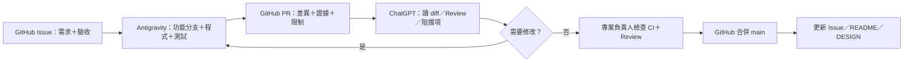

# 第二組｜Antigravity × ChatGPT × GitHub 協作流程

**正式運作模式**：第二組仍為三人課程團隊，但目前只有一位專案負責人實際管理與開發。Antigravity 寫程式、ChatGPT 做 GitHub Review，負責人完成最終驗收及 Merge。**不預設其他組員參與，也不要求第二位真人 Review**。

## 唯一交接流程

### 實作端：Antigravity
1. `git fetch origin && git switch main && git pull --ff-only origin main`
2. 在 GitHub Issue 寫明：問題、範圍、相關 FR、資料來源、失敗狀態、驗收條件、測試。沒有 Issue 先建立，不自行擴張到 P1 或路線功能。
3. `git switch -c feat/<issue>-<slug>`；讀 `AGENTS.md`、`DESIGN.md`、SRS、API Contract、相依測試。
4. 最小變更、增加離線測試、文件同步，`git add`、`git commit`、`git push -u origin <branch>`，建立 PR（可以 Draft）。
5. 使用 PR Template 填寫完整內容；**禁止在 PR 填假測試結果**。

### 審核端：ChatGPT
- 使用者在 ChatGPT 傳「請審核 `https://github.com/sam052003/AirGuard-AI/pull/N`，以 main 的 AGENTS／SRS／DESIGN／API Contract 為準」。
- ChatGPT 必須取得最新 PR changed files 與 diff，必要時讀完整檔、CI 狀態、Issue 和相關測試；不能只憑 Antigravity 描述核准。
- 在 GitHub PR 建立 Review 或 Comment，列出 Blocking、重大及非阻擋項。若未能真正跑測試，註明「僅靜態審查」。
- 修正後使用者再次傳同一個 PR URL 請重新審核**最新 SHA**。ChatGPT 不會在沒有新對話指令時自動巡檢或合併。

### 人工作業與權限
- **合併前**：負責人核對最新 PR HEAD SHA 與 Python 3.11／3.12 CI、需求／文件與實測資料、沒有未解決 BLOCKER。非阻擋事項需在 PR／Issue 留下後續追蹤。ChatGPT 的「建議合併」不代表 Merge 已授權。
- **GitHub Rulesets**：建議在 Settings → Rules → Rulesets 設定必須經 PR、必要 Python CI 且禁止 Force Push；目前僅一位人類負責人，**請勿設定必須有其他 Reviewer APPROVE**。倉庫管理員須自行設定，文件本身不會修改 Rulesets。
- 若 ChatGPT 與 PR 作者使用同一 GitHub 帳號，GitHub 不允許自己正式核准自己的 PR；使用 `COMMENTED` 記錄技術審核即可，不用等待其他真人核准。最終是否 Merge 由專案負責人明確決定，ChatGPT 不會在未獲指示時自行合併。
- API Key 僅存在本機 `.env` 或部署 Secrets；需要真實資料時由專案負責人在本機執行。CI 一律使用合成資料。

## 必要命名及交接格式

Issue 標題：`[W1][FR-02] 臺中測站資料盤點與缺值報告`

Branch：`feat/12-station-quality-report`

PR 標題：`feat(data): 加入逐時資料品質報告 (#12)`

PR 內：`Closes #12`、變更摘要、實測命令及輸出、風險與回退、設計修改、未驗證項目。

Review 內：`Verdict: CHANGES_REQUESTED / REVIEWED_WITH_CAVEATS / READY_FOR_HUMAN_MERGE`，逐項提供 `[BLOCKER|MAJOR|MINOR] 路徑：原因→驗證→修正`。

## 最後期末交付物
在真正完成後才新增真實的安裝／執行、資料、模型版本、指標、Demo、Final PPT（超過 20 頁）、YouTube 影片（超過 10 分鐘）、限制與結論；不得因 PR 文件寫了預期結果就宣稱已實測。

[AGENTS.md](../AGENTS.md)｜[PR 審核清單](reviewer-checklist.md)｜[開發路線](implementation-roadmap.md)
